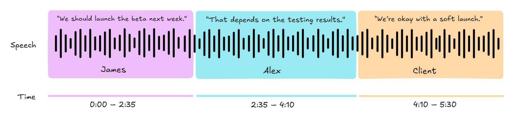
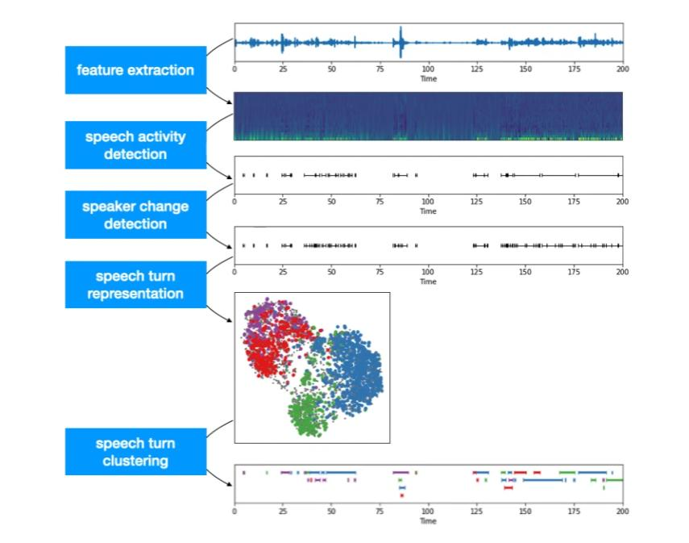
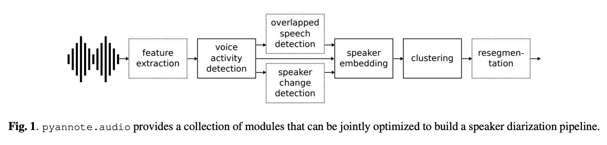

# 3. Diarización: fundamentos

## 3.1 ¿Qué es?

La diarización de hablantes responde **"¿quién habló y cuándo?"**.



En la figura hay tres turnos: James de 0:00 a 2:35, Alex hasta 4:10 y el cliente hasta 5:30. Pero **el sistema no conoce los nombres**: produce etiquetas anónimas como `SPK_A` o `SPEAKER_00`. Ponerles nombre es otra tarea (identificación de hablante), que requiere voces registradas de antemano.

### Formato de salida estándar: RTTM

Una línea por segmento: archivo, canal, **inicio**, **duración** y **etiqueta**.

```
SPEAKER audio 1   0.00 155.0 <NA> <NA> SPK_A
SPEAKER audio 1 155.0   95.0 <NA> <NA> SPK_B
```

Es el formato de las referencias de los datasets públicos (AMI, DIHARD, VoxConverse) y el que usan las herramientas de evaluación.

### Las dos partes del problema

1. **Segmentar:** detectar cuándo hay voz y cuándo cambia el hablante.
2. **Agrupar:** decidir qué segmentos pertenecen a la misma persona, **sin saber cuántas personas hay**.

### Retos clásicos

- **Solapamiento:** dos personas hablan a la vez (frecuente en conversaciones reales).
- **Turnos cortos:** "sí", "ajá"; poca voz para reconocer al hablante.
- **Ruido** y **habla amortiguada** (micrófono lejano, llamadas).
- **Voces parecidas.**
- **Audios largos:** hay que mantener la identidad durante horas.

> **Idea clave:** las etiquetas son anónimas (`SPK_A`, `SPK_B`…): la diarización **agrupa voces, no identifica personas**.

## 3.2 Enfoque clásico: pipeline en cascada



El pipeline clásico encadena etapas, cada una alimentando a la siguiente:

1. **Extracción de rasgos:** de la onda a un espectrograma o MFCC.
2. **Detección de actividad de voz (VAD):** dónde hay habla.
3. **Detección de cambio de hablante:** dónde termina un turno y empieza otro.
4. **Representación de cada turno:** un embedding por segmento. En la nube de puntos de la figura, los embeddings de cada hablante forman grupos de color.
5. **Clustering:** agrupar los embeddings; cada grupo es un hablante.

### Limitaciones del enfoque en cascada

| Limitación | Por qué ocurre | Consecuencia |
|------------|----------------|--------------|
| **Un hablante por segmento** | Cada segmento recibe una sola etiqueta | El solapamiento se ignora o se asigna mal |
| **Errores en cadena** | Cada etapa depende de la anterior | Un fallo del VAD o del detector de cambios se arrastra hasta el clustering y no se recupera |
| **Embeddings sobre segmentos cortos** | Se corta el audio en trozos de 1–2 s | Poca voz por segmento → huellas vocales ruidosas → clustering difícil |
| **Módulos aislados** | Cada etapa se entrena y ajusta por separado | Nadie optimiza el resultado final |

## 3.3 pyannote.audio: módulos que se optimizan juntos



*Figura de [Bredin et al., 2020](https://arxiv.org/abs/1911.01255): pyannote.audio ofrece módulos que pueden optimizarse conjuntamente.*

pyannote.audio conserva la estructura modular, pero **reemplaza VAD, detección de cambios y detección de solapamiento por una sola red de segmentación** entrenada de extremo a extremo ([Bredin & Laurent, 2021](https://arxiv.org/abs/2104.04045)). Esa red ve directamente cuántos hablantes hay en cada instante, incluidos los solapamientos.

> **Idea clave:** pyannote mantiene la idea modular, pero sustituye las primeras etapas por una red que ve solapamientos.

## 3.4 Enfoque pyannote: local + global en 3 fases

Esta es la idea central del proyecto, descrita en el paper de [Bredin (2023)](https://www.isca-archive.org/interspeech_2023/bredin23_interspeech.html).

**El problema:** la red neuronal es muy buena en **ventanas cortas** (dentro de 10 s detecta quién habla, incluso si hay dos personas a la vez), pero:
- no puede procesar una hora de audio de una vez;
- no sabe que el "hablante 1" de una ventana es el mismo que el "hablante 2" de otra.

**La solución es híbrida:**

| Fase | Nombre | Qué hace | Salida |
|------|--------|----------|--------|
| **1** | Preparación | Aplica la red ventana por ventana (10 s) y binariza | Quién de los `K` hablantes locales está activo en cada frame |
| **2** | Procesamiento local | Extrae un embedding por cada hablante local activo en cada ventana, usando solo su voz limpia | Conjunto de embeddings `e(w,k)` |
| **3** | Procesamiento global | Agrupa los embeddings con clustering aglomerativo y reconstruye la diarización frame a frame | Turnos por hablante global (`SPK_A`, `SPK_B`…) |

> **Idea clave:** lo **local** (10 s) es preciso y ve solapamientos; lo **global** da coherencia a lo largo de todo el audio.

Una forma de verlo: la red resuelve el "cuándo" con mucha resolución pero con memoria corta; el clustering resuelve el "quién" con memoria larga pero sin resolución temporal. Combinarlos da lo mejor de ambos.

Los tres archivos siguientes explican cada fase en detalle.
