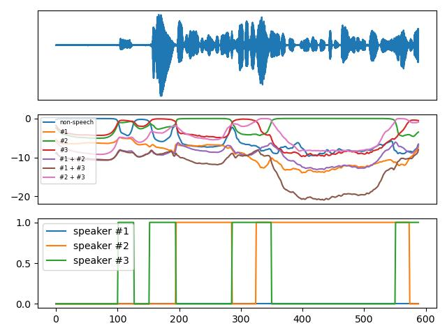
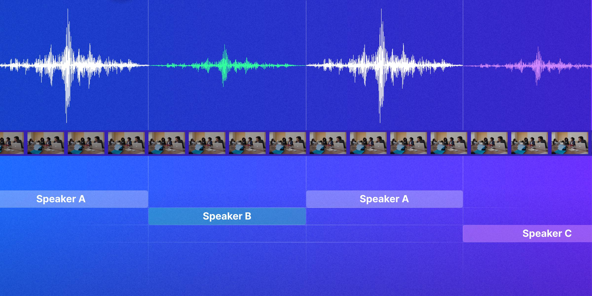

# 4. Fase 1: preparación

La preparación tiene dos partes: la **segmentación local** (la red neuronal produce probabilidades) y la **segmentación binaria** (esas probabilidades se convierten en decisiones 0/1).

## 4.1 Segmentación local mediante red neuronal

### Ventana deslizante

Recorremos el audio con una **ventana de 10 s** que avanza **de a 1 s**. Por tanto:
- dos ventanas consecutivas se solapan un **90 %**;
- **cada instante del audio lo analizan unas 10 ventanas distintas**.

Esa redundancia da robustez: si una ventana se equivoca en un instante, las otras nueve lo compensan al promediar (Fase 3).

En pyannote 3.1, el paso es un parámetro: `segmentation_step = 0.1` (10 % de la duración de la ventana, es decir 1 s).

### La red: PyanNet

Cada ventana entra a la red **PyanNet**:

```
onda (10 s, 16 kHz) ──► SincNet ──► LSTM bidireccional ──► capas lineales ──► clase por frame
```

| Capa | Qué hace |
|------|----------|
| **SincNet** ([Ravanelli & Bengio, 2018](https://arxiv.org/abs/1808.00158)) | Aprende **filtros paso banda directamente sobre la forma de onda**. Cada filtro solo tiene dos parámetros (frecuencias de corte), así que aprende rápido y con pocos datos. Reemplaza al espectrograma "a mano". |
| **LSTM bidireccional** | Modela el **contexto temporal**: para decidir quién habla en un frame mira lo que pasa antes y después. |
| **Capas lineales** | Clasifican cada frame. |

**Resolución:** 589 frames por ventana de 10 s, es decir **≈17 ms por frame**.

### Salida powerset

En la versión 3.0 del modelo (`pyannote/segmentation-3.0`) la salida es **powerset** ([Plaquet & Bredin, 2023](https://arxiv.org/abs/2310.13025)). En vez de predecir una probabilidad independiente por hablante, se predice **una de 7 clases**, que incluyen las combinaciones de dos hablantes:

| Clase | Significado |
|-------|-------------|
| 0 | silencio (nadie habla) |
| 1 | solo `#1` |
| 2 | solo `#2` |
| 3 | solo `#3` |
| 4 | `#1` + `#2` |
| 5 | `#1` + `#3` |
| 6 | `#2` + `#3` |

Así el modelo **aprende explícitamente el solapamiento** como una clase propia. Las restricciones de diseño son: máximo **3 hablantes por ventana** y máximo **2 hablando a la vez**. En 10 s de conversación real eso casi siempre se cumple.

**¿Por qué powerset y no multilabel?** En el enfoque multilabel clásico, cada hablante tiene su sigmoide y hay que elegir un umbral `θ` para decidir; ese umbral es un hiperparámetro sensible. Con powerset basta elegir la clase más probable (*argmax*): **no hay umbral que ajustar**.



*Arriba: la onda de una ventana. Centro: log-probabilidades de las 7 clases powerset. Abajo: actividad binaria de cada hablante local.*

### Forma de la salida

Un tensor **C × F × K** (ventanas × frames × hablantes locales):

```
s(w) ∈ [0,1]^(F×K)    probabilidad de que el hablante local k hable en el frame f de la ventana w
```

> **Idea clave:** `#1`, `#2` y `#3` son **nombres locales**: solo tienen sentido dentro de su ventana.

## 4.2 Primer problema: de hablante local a global



La red numera a los hablantes **de forma arbitraria en cada ventana**. En la ventana `w`, el `#1` puede ser Ana; en la ventana `w+1`, el `#1` puede ser Luis. Es el **problema de permutación**. En la figura, el hablante A reaparece después de B y debe recibir siempre la misma etiqueta global.

Lo que necesitamos es una **función de asignación por ventana**:

```
πw : {1, …, K} → {A, B, …}
```

que lleve cada índice local a una identidad global.

**Esa función no se puede obtener del índice:** se obtiene **comparando voces**. Por eso las fases siguientes extraen un embedding por hablante local (Fase 2) y luego los agrupan (Fase 3).

**Restricción lógica:** dos hablantes locales distintos **de la misma ventana** nunca pueden ser la misma persona global (si la red los separó, es porque suenan distinto en ese momento).

> **Idea clave:** el orden `#1`/`#2` es arbitrario en cada ventana; **la identidad la decide la voz (el embedding), no el índice**.

## 4.3 Segmentación binaria de hablantes locales

La red entrega probabilidades continuas entre 0 y 1. Para usarlas hay que decidir: **¿habla o no habla?**

```
b(w)f,k = 1   si  s(w)f,k > θ
          0   en otro caso
```

### Ejemplo ilustrativo (θ = 0.5)

Probabilidad de un hablante local a lo largo de 80 frames (datos ilustrativos del PPT):

```
s:  0.05 0.08 … 0.36 0.49 │0.56 0.63 0.77 0.86 … 0.65 0.59│ 0.46 0.33 … 0.49 │0.54 0.57 … 0.62 0.50│ 0.45 … 0.07
b:   0    0   …  0    0   │ 1    1    1    1   …  1    1  │  0    0   …  0   │ 1    1   …  1    1  │  0   …  0
         frames 0–12          frames 13–23 (habla)            24–45             46–58 (habla)           59–79
```

La decisión binaria convierte una curva suave en dos tramos de habla bien definidos.

### Cómo proceder

1. **Obtener `s`** para cada ventana (segmentación local).
2. **Binarizar:**
   - *Modelo multilabel:* aplicar el umbral `θ`, preferiblemente **con histéresis**: un umbral para activar (*onset*) y otro, más bajo, para desactivar (*offset*). Así una probabilidad que oscila alrededor de 0.5 no produce "parpadeos" (1, 0, 1, 0…).
   - *Modelo powerset (pyannote 3.x):* en cada frame se elige la clase más probable (por ejemplo `#1+#2`) y se convierte a la forma multilabel (one-hot → `b = [1, 1, 0]`). **No requiere `θ`.** En el código de pyannote esto lo hace `utils/powerset.py`.
3. **Limpiar:** eliminar activaciones y silencios de duración menor a un mínimo (`min_duration_on`, `min_duration_off`).
4. **Guardar** el tensor binario C × F × K: `binary_segments` en DASR.

> **Idea clave:** binarizar convierte "qué tan probable" en una decisión "habla / no habla", que es lo que necesitan las fases siguientes.

## 4.4 ¿Por qué hacer segmentación binaria?

Si ya tenemos probabilidades, ¿para qué binarizar? Porque varias operaciones del pipeline requieren **decisiones discretas**:

| Razón | Explicación |
|-------|-------------|
| **Máscaras limpias** | Para excluir el solapamiento hay que saber con certeza quién habla (`b = 1`) y quién no en cada frame. Con probabilidades no hay frontera clara. (Fase 2) |
| **Contar hablantes** | La reconstrucción necesita un **número entero** `Kf` de hablantes por frame, que se obtiene sumando `b`. (Fase 3) |
| **VAD para el ASR** | Hay voz si algún `b` está activo: el ASR solo transcribe esas regiones. |
| **Filtrar inactivos** | Un hablante local que nunca supera el umbral **no genera embedding**: menos ruido para el clustering y menos cálculo. |
| **Robustez** | La histéresis y las duraciones mínimas eliminan activaciones débiles y parpadeos. |
| **Interpretabilidad** | Una salida 0/1 se puede auditar y comparar con la referencia RTTM y entre implementaciones (la nuestra vs. pyannote). |

**Importante:** no descartamos las probabilidades. Se siguen usando en la reconstrucción (Fase 3) para decidir **qué** clústeres están activos.

> **Idea clave:** la probabilidad `s` sirve para **puntuar** (quiénes); la decisión `b` sirve para **seleccionar, contar y recortar** (cuántos y dónde).
