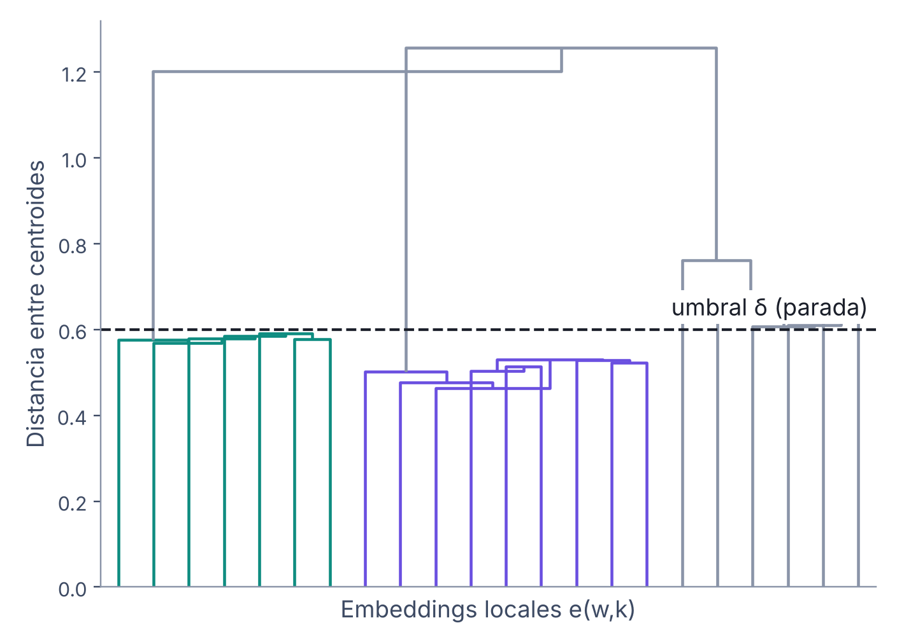
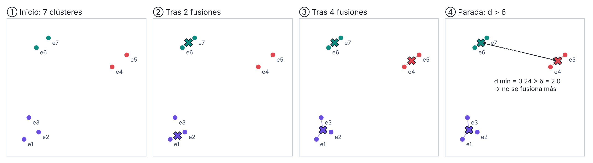
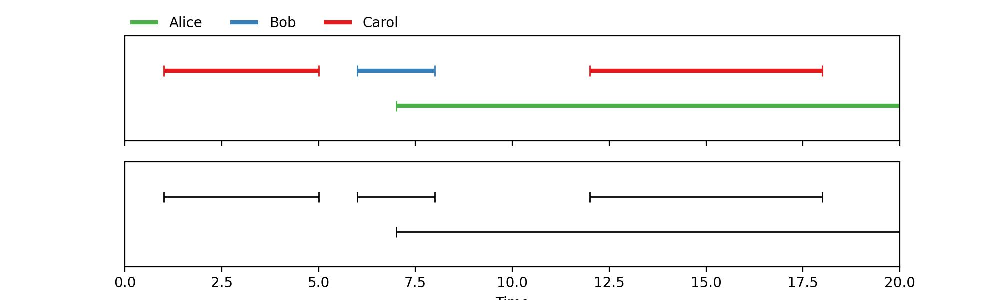

# 6. Fase 3: procesamiento global

Tenemos un **conjunto de embeddings** `e(w,k)`, uno por hablante local activo en cada ventana. Queremos asignar cada uno a un **hablante global**. Eso resuelve el problema de permutación de la Fase 1: si `e(w,1)` y `e(w+1,2)` caen en el mismo grupo, el `#1` de la ventana `w` y el `#2` de la ventana `w+1` son la misma persona.

**Particularidad de nuestros datos:** no forman una secuencia regular. Puede haber 0, 1, 2 o 3 embeddings por ventana, las ventanas se solapan y hay frames excluidos.

## 6.1 ¿Qué método de clustering usar?

| Método | Idea | ¿Exige orden cronológico / periodicidad? | ¿Cómo decide el nº de hablantes? |
|--------|------|------------------------------------------|----------------------------------|
| **Spectral Clustering** | Matriz de afinidad → autovectores → k-means | No | Brecha de autovalores (*eigengap*) |
| **VBx** (Variational Bayes + HMM) ([Landini et al., 2022](https://arxiv.org/abs/2012.14952)) | Modelo bayesiano: los x-vectors forman una cadena de Markov de hablantes | **Sí**: una secuencia de embeddings con paso fijo | Inferencia variacional (*priors*) |
| **AHC con enlace de centroides (UPGMC)** | Fusionar iterativamente los dos grupos con centroides más cercanos | **No**: trabaja con un conjunto desordenado | Umbral de distancia `δ` como criterio de parada |

**Nuestra elección:** clustering aglomerativo jerárquico (AHC) con enlace de centroides.

> **Idea clave:** nuestros embeddings son irregulares (varios por ventana, con huecos), así que preferimos un método que no asuma orden temporal.

## 6.2 ¿Por qué AHC (UPGMC) y no SC o VBx?

### Por qué no Spectral Clustering
- Debe **estimar el número de hablantes** con la brecha de autovalores, que es **inestable** con pocos embeddings o con hablantes desbalanceados (uno habla mucho más que otro).
- Requiere **refinar la matriz de afinidad** (poda por percentil, simetrización…): más hiperparámetros poco interpretables.
- La descomposición espectral cuesta **O(N³)**: cara en audios largos.

### Por qué no VBx
- Su formulación original es un **HMM sobre x-vectors extraídos con paso fijo y en orden cronológico**.
- Nuestros `e(w,k)` son un conjunto irregular: 0–3 por ventana, ventanas solapadas, frames excluidos.
- Necesita un **modelo PLDA entrenado** y más hiperparámetros (`Fa`, `Fb`, `P_loop`); además suele **inicializarse con AHC**.

### Por qué sí AHC con centroides
- Trabaja sobre un **conjunto sin orden**: encaja con la forma de `e(w,k)`.
- Un **umbral interpretable** (`δ`) más `min_cluster_size`; **no exige conocer** el número de hablantes.
- **Determinista y explicable** (se puede dibujar el dendrograma); admite restricciones por ventana.
- **Es la receta de pyannote 3.1**, la versión que reproducimos.

> **Idea clave:** SC y VBx no son peores en abstracto; AHC es el que **mejor encaja con la forma de nuestros datos y con el objetivo de reproducir**.

**El clustering también importa fuera de la diarización.** En verificación de hablantes autosupervisada, se agrupan embeddings sin etiquetas para crear pseudo-etiquetas con las que entrenar. [Fathan & Alam (2024)](https://www.sciencedirect.com/science/article/abs/pii/S0167865524000242), en *Pattern Recognition Letters*, comparan varios algoritmos de clustering para esa tarea y encuentran una **alta correlación entre las métricas de calidad del clustering y el rendimiento final**. Es un argumento más para medir y elegir con cuidado el método de clustering. *(Resumen basado en la reseña del artículo; el texto completo no es de acceso libre.)*

**Matiz importante:** pyannote 4.0 (*community-1*, septiembre 2025) **cambió su clustering por defecto a VBx**, adaptado a estos embeddings locales por investigadores de BUT, y obtiene mejor DER. Por eso VBx queda como **extensión a evaluar más adelante**, no como algo descartado.

## 6.3 El algoritmo: AHC con enlace de centroides



*Dendrograma (datos sintéticos): cortar en `δ` deja 3 clústeres = 3 hablantes globales.*

1. **Inicializar.** Cada embedding, **normalizado** (`‖e‖ = 1`), es su propio clúster. La normalización hace que la distancia euclídea se comporte como una distancia angular (coseno), que es la que importa entre embeddings de voz.
2. **Medir.** La distancia entre dos grupos es la distancia entre sus centroides (sus promedios):
   ```
   d(A,B) = ‖μA − μB‖
   ```
3. **Fusionar** el par más cercano. El nuevo centroide es el promedio ponderado por tamaño:
   ```
   μ(A∪B) = (nA·μA + nB·μB) / (nA + nB)
   ```
4. **Parar** cuando la menor distancia entre centroides supera `δ`. Ese es el criterio de parada y **define cuántos hablantes salen**. Si se conoce el número de hablantes `K`, se puede parar al llegar a `K` grupos.
5. **Ajustar** (pasos propios de pyannote):
   - Los clústeres **pequeños** (menos de `min_cluster_size` embeddings) se consideran poco fiables y sus miembros se reasignan al **centroide grande más cercano**.
   - La asignación final se hace **ventana por ventana con el algoritmo húngaro**, para que dos hablantes locales de la misma ventana no queden en el mismo hablante global (la restricción de la Fase 1).

**Valores de la receta 3.1:** `δ ≈ 0.7046` y `min_cluster_size = 12`. *(La configuración oficial en Hugging Face pide iniciar sesión; estos valores coinciden en varias copias públicas de la configuración.)* En el código, si hay muy pocos embeddings, `min_cluster_size` se reduce automáticamente a `max(1, round(0.1 · N))`.

> **Idea clave:** `δ` controla cuántos hablantes salen: **`δ` bajo → se separa de más; `δ` alto → se mezclan voces.**

## 6.4 Ejemplo guiado: AHC paso a paso



Siete embeddings en 2 dimensiones (en la realidad son 256), con `δ = 2.0`:

| Paso | Fusión | Distancia | Grupos que quedan |
|------|--------|-----------|-------------------|
| Inicio | — | — | 7 grupos: {e1} {e2} {e3} {e4} {e5} {e6} {e7} |
| 1 | e6 + e7 | 0.64 | 6 |
| 2 | e1 + e2 | 0.67 | 5 |
| 3 | (e1,e2) + e3 | 0.76 | 4 |
| 4 | e4 + e5 | 0.78 | 3 |
| Parada | — | menor distancia restante = **3.24 > δ = 2.0** | **3 grupos = 3 hablantes globales** |

La ✕ de la figura marca el centroide: tras cada fusión **se recalcula**, y es el que se usa para medir la siguiente distancia.

Cada embedding local hereda la etiqueta de su grupo. Con eso, cada hablante local de cada ventana queda asignado a un hablante global: **el problema de permutación está resuelto**.

## 6.5 ¿Por qué enlace de centroides y no otro?

El "enlace" (*linkage*) define cómo se mide la distancia entre dos grupos:

| Enlace | Cómo mide A ↔ B | Riesgo en diarización |
|--------|-----------------|-----------------------|
| **Single** | Par más cercano | **Encadenamiento:** un embedding ruidoso (por ejemplo, con solapamiento residual) "puentea" dos voces y se fusionan hablantes distintos. |
| **Complete** | Par más lejano | Un solo **atípico** impide fusionar: el mismo hablante se parte en varios (se **sobreestima** el número de hablantes). |
| **Average (UPGMA)** | Media de todos los pares | Competidor cercano; penaliza a hablantes con mucha **variabilidad interna** (emoción, cambios de canal), que parecen lejanos de sí mismos. Cuesta O(nA·nB). |
| **Ward** | Aumento de la varianza | Favorece grupos de **tamaño parecido**, pero en una conversación suele dominar un hablante; como su coste crece con el tamaño del grupo, un `δ` fijo **pierde significado**. |
| **Centroid (UPGMC)** | Distancia entre voces promedio | Promediar **reduce el ruido** de cada embedding; `δ` = distancia entre prototipos de voz. |

### Por qué centroide
- Compara **prototipos de voz**, no embeddings sueltos.
- `δ` tiene un **sentido estable** en la esfera unitaria.
- Sigue la **misma lógica** que la reasignación por centroide posterior.
- Según el PPT, dio el **mejor DER en la validación del equipo**. *(Conviene documentar ese experimento con sus números en el informe final.)*

**Cuidado:** el enlace de centroides puede producir **inversiones en el dendrograma** (una fusión posterior a menor distancia que una anterior) y solo es válido con **distancia euclídea**. Por eso se normalizan los embeddings antes (pyannote lo hace explícitamente en `clustering.py`).

> **Idea clave:** cada hablante queda representado por su **voz promedio**. Es la misma idea que usa la reconstrucción para decidir quién habla.

## 6.6 Reconstrucción: de clústeres a diarización final

Ya sabemos a qué hablante global corresponde cada hablante local. Falta construir la diarización final **frame a frame** sobre todo el audio.

### Paso 1: contar hablantes por frame

```
Kf = round( (1/|Wf|) · Σ(w∈Wf) Σk b(w)f,k )
```

`Wf` son las ventanas que cubren el frame `f`. Para cada una se cuenta cuántos hablantes locales están activos, se promedia entre ventanas y se redondea. *(Detalle de pyannote: antes de promediar se descarta el 10 % de cada borde de la ventana, donde la red tiene menos contexto y se equivoca más.)*

### Paso 2: puntuación instantánea por clúster

```
S(f,c) = Σ(w∈Wf) Σ(k: πw(k)=c) s(w)f,k
```

Para cada hablante global `c`, se suman las probabilidades de los hablantes locales que fueron asignados a `c`, en todas las ventanas que cubren el frame.

### Paso 3: seleccionar

```
y(f,c) = 1   si  c ∈ top-Kf de S(f,·)
```

En cada frame se eligen los `Kf` hablantes globales con mayor puntuación.

### Paso 4: de frames a tiempo

```
tf = t0 + f·Δ      (Δ ≈ 17 ms)
```

Se convierten los índices de frame a segundos y se **unen frames contiguos** del mismo hablante en turnos.



*Salida final: segmentos por hablante global. Puede haber solapamiento (Alice con Bob o Carol).*

**Modo exclusivo:** si se fuerza `Kf ≤ 1`, sale **un solo hablante por instante**. Es útil para la fusión con el ASR, porque cada palabra tendrá un único candidato. pyannote 4.0 lo ofrece como salida aparte (`exclusive_speaker_diarization`).

> **Idea clave:** la segmentación **binaria** dice **cuántos** hablan en cada frame; la puntuación de los clústeres dice **quiénes**.

## 6.7 Ejemplo guiado: reconstrucción de un frame `f`

Un frame cubierto por tres ventanas (valores ilustrativos; `θ = 0.5`):

| Ventana | Local #1 (s → clúster) | Local #2 | Local #3 | Σ b (activos) |
|---------|------------------------|----------|----------|---------------|
| w1 | 0.92 → A | 0.81 → B | 0.05 → C | 2 |
| w2 | 0.88 → B | 0.10 → A | 0.35 → C | 1 |
| w3 | 0.07 → C | 0.95 → A | 0.76 → B | 2 |

Cada ventana numera a sus hablantes a su manera: en w1, A es `#1`; en w3, A es `#2`.

**Paso 1, contar:** `Kf = round((2 + 1 + 2) / 3) = round(1.67) = 2`.

**Paso 2, puntuar:**

| Clúster | Suma | S(f,c) |
|---------|------|--------|
| A | 0.92 + 0.10 + 0.95 | **1.97** |
| B | 0.81 + 0.88 + 0.76 | **2.45** |
| C | 0.05 + 0.35 + 0.07 | 0.47 |

**Paso 3, seleccionar:** los 2 clústeres con mayor `S` son **B y A**. En el frame `f` hablan A y B a la vez (solapamiento).

> **Idea clave:** aunque cada ventana numere distinto, al pasar por `πw` las probabilidades se suman sobre **la misma identidad global**.

### Nota sobre la implementación de pyannote

En `reconstruct()`, pyannote toma dentro de cada ventana el **máximo** de las probabilidades de los locales asignados a un clúster y luego **suma** entre ventanas (`to_diarization`). Como la restricción del algoritmo húngaro impide que dos locales de la misma ventana vayan al mismo clúster, ese máximo es el valor del único local asignado, y el resultado coincide con la fórmula de suma del paso 2.
