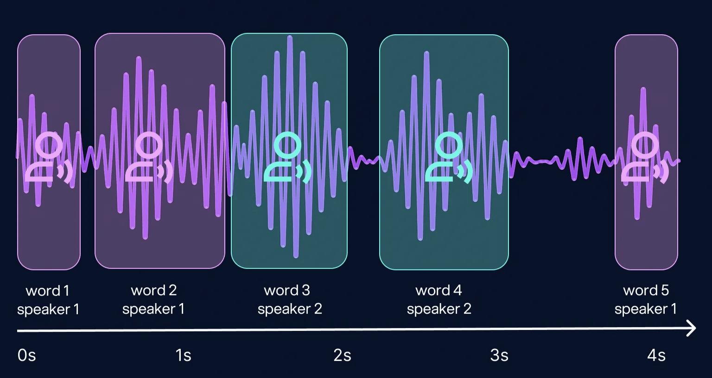

# 7. Fusión ASR + diarización: `Pipeline.assign_speakers`

Tenemos dos tablas con tiempos:
- **ASR:** palabras con `[inicio, fin]`;
- **Diarización:** turnos con `[inicio, fin, hablante]`.

La fusión les pone a las palabras el hablante que las dijo.



*Cada palabra, con su intervalo de tiempo, recibe el hablante cuyo turno la cubre.*

## 7.1 Regla principal: máxima intersección temporal

```
hablante(wi) = argmax_c | [t_ini_i, t_fin_i] ∩ turnos(c) |
```

Para cada palabra `wi` se calcula **cuánto se solapa su intervalo** con los turnos de cada hablante `c`, y se le asigna el de **mayor intersección**.

**Ejemplo.** La palabra "beta" va de 1.90 a 2.30 s. El turno de `SPK_A` termina en 2.20 s y el de `SPK_B` empieza en 2.10 s:
- intersección con `SPK_A`: 2.20 − 1.90 = 0.30 s;
- intersección con `SPK_B`: 2.30 − 2.10 = 0.20 s;
- → "beta" se asigna a `SPK_A`.

## 7.2 Casos especiales

| Caso | Qué hacer |
|------|-----------|
| **Sin intersección** (la palabra cae en un hueco entre turnos) | Asignar el turno **más cercano en el tiempo**. Suele pasar con palabras muy cortas que la diarización recortó. |
| **Solapamiento** (dos hablantes activos durante la palabra) | Usar la **diarización exclusiva** (un solo hablante por instante, [archivo 6](06-fase3-procesamiento-global.md#66-reconstrucción-de-clústeres-a-diarización-final)) para evitar la ambigüedad. |
| **Turnos** | Agrupar palabras consecutivas del mismo hablante en frases. |

## 7.3 Salida

Una transcripción tipo guion: tiempo, hablante y texto.

```
[00:12.4 → 00:15.1] SPK_A: "Deberíamos lanzar la beta la próxima semana."
[00:15.3 → 00:17.0] SPK_B: "Eso depende de los resultados de las pruebas."
```

> **Idea clave:** el tiempo es la "llave" común: ASR y diarización se unen **como dos tablas por intervalos** (un *join* temporal).

## 7.4 Limitaciones de la fusión en cascada

- Las **fronteras no coinciden**: el ASR y la diarización deciden por separado dónde empiezan y terminan las cosas. Las palabras justo en un cambio de turno son las que más se equivocan.
- Si la diarización **no detectó** un tramo de voz, sus palabras quedan asignadas al turno más cercano, que puede ser de otra persona.
- Por eso la investigación reciente (2024–2026) explora **modelos conjuntos** de diarización y ASR, que deciden las dos cosas a la vez. Se comentan en el [archivo 12](12-contexto-alternativas-limitaciones.md#123-modelos-conjuntos-diarización--asr). Para este proyecto, la fusión por intervalos es la opción adecuada: es simple, explicable y es lo que hace WhisperX. Además, una evaluación de 2026 sobre cinco pipelines abiertos ([Amorim et al.](https://onlinelibrary.wiley.com/doi/10.1111/exsy.70221)) encontró que los sistemas de solo diarización y los conjuntos con ASR son **competitivos entre sí**, así que la cascada no parte en desventaja.
